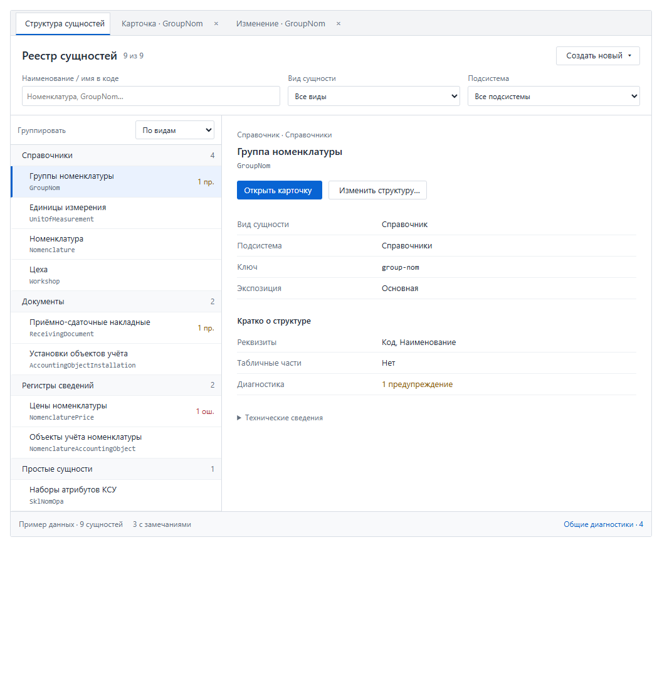

# Реестр сущностей: дерево, обзор и отдельные рабочие вкладки

Дата: 2026-11-10.

Статус: пользователь выбрал вариант интерфейса; план внедрения подготовлен, реализация не начата.

Цель: сделать «Структуру сущностей» самостоятельным читаемым реестром. Пользователь находит сущность, видит её краткое описание и открывает просмотр либо изменение структуры в отдельной рабочей вкладке приложения.

## 1. Принятый интерфейс

Основа — выбранный в обсуждении вариант «Дерево и обзор» с последующими уточнениями:

1. Слева дерево **групп и сущностей**. Название сущности и имя класса показаны двумя строками. Разделы карточки, реквизиты и табличные части в дерево реестра не вкладываются.
2. Справа краткий обзор выбранного типа и две кнопки: **«Открыть карточку»**, **«Изменить структуру…»**.
3. Фильтры постоянно видны в порядке **«Наименование / имя в коде» → «Вид сущности» → «Подсистема»**. Поиск сопоставляет часть подписи или имени класса без учёта регистра; остальные фильтры работают с ним по пересечению.
4. Группировка «По видам / По подсистемам» расположена отдельно над деревом.
5. **«Создать новый»** раскрывает меню: «Справочник», «Документ», «Регистр сведений», «Простая сущность».
6. Карточка EntityExplorer и изменение структуры открываются в отдельных вкладках существующего Workspace. Повторное открытие того же типа в том же режиме активирует имеющуюся вкладку.
7. При переключении вкладок сохраняются фильтры и выбор реестра, место просмотра в каждой карточке и ввод редактора.
8. Отдельного блока «Перейти к разделу» в реестре нет. Раздел выбирается внутри открытой карточки.

Изображение фиксирует компоновку и сценарий вкладок. Диагностики и количества в эскизе демонстрационные; при внедрении все значения берутся из настоящего снимка метаданных. Внешняя оболочка и полоса вкладок предоставляются штатным Workspace.

## 2. Что обнаружено в действующем коде

| Участок | Текущее поведение | Следствие для внедрения |
|---|---|---|
| [EntityExplorerView](../../src/main/java/org/ip/views/admin/EntityExplorerView.java) | Один `@UIScope`-компонент владеет каталогом, фильтрами, деревом, выбранным типом и кешем карточек. | Реестр и карточку одного типа необходимо разделить; простое изменение CSS не реализует принятую навигацию. |
| [MainLayout](../../src/main/java/org/ip/views/MainLayout.java) | Меню, прямые ссылки и программные переходы используют общий `EXPLORER_ENTRY_ID = "entity-explorer"`. | Вход из меню должен открывать реестр, а вход по типу — вкладку карточки этого типа. Адрес привязывается к конкретной вкладке. |
| [ExplorerTreeModel](../../src/main/java/org/ip/views/admin/ExplorerTreeModel.java), [ExplorerSnapshot](../../platform-vaadin/src/main/java/org/ipro/vaadin/explorer/ExplorerSnapshot.java) | Уже есть типы, подсистемы, классификация, диагностики, подтверждённые секции и поисковые признаки. Старое дерево также содержит разделы и поля. | Использовать существующие факты; для реестра сделать более простую проекцию. |
| [EntityExplorerNavigation](../../src/main/java/org/ip/views/admin/EntityExplorerNavigation.java) | Получает каталог и сообщения через единственный `EntityExplorerView`. | Переподключить к общему поставщику снимка и к конкретной открываемой карточке. |
| [EntityExplorerPilotPolicy](../../src/main/java/org/ip/views/admin/EntityExplorerPilotPolicy.java) | Компактная карточка включается флагом и поддерживает `Nomenclature` и `ReceivingDocument`; остальные типы используют существующее представление. | Реестр работает со всем каталогом, а карточки продолжают использовать действующую политику представления. |
| [EntityModifyWorkspace](../../src/main/java/org/ip/views/admin/EntityModifyWorkspace.java) | Уже открывает отдельную вкладку `entity-modify:<FQCN>` для класса. | Переиспользовать текущий host и редактор изменений. |
| [EntityModificationService](../../src/main/java/org/ip/views/admin/EntityModificationService.java) | Изменение требует допуска и доступного исходника; запись дополнительно зависит от `allow-source-write`. | Доступность кнопки и команды должна следовать действующим ограничениям. |
| [EntityDraftWorkspace](../../src/main/java/org/ip/views/admin/EntityDraftWorkspace.java), [EntityDraftEditorView](../../src/main/java/org/ip/views/admin/EntityDraftEditorView.java) | Создание открывается отдельной общей вкладкой с выбором рецепта и защитой замены черновика. | Добавить вход с выбранным видом, сохранив существующий ввод и защиту его замены. |
| [RecipeCatalog](../../entity-design-core/src/main/java/org/ipro/design/RecipeCatalog.java) | Есть рецепты справочника, документа и независимого регистра. `EXISTING_ENTITY` — режим чтения существующего файла, а не рецепт создания. Рецепта создания `PLAIN` нет. | Полноценный пункт «Простая сущность» требует отдельного этапа генератора. |

## 3. Поведение реестра

### 3.1. Поиск и дерево

- Поиск по подписи сущности и `simpleName` класса: `Группы`, `GroupNom`, `groupnom` находят `GroupNom`; `nomenclature` находит соответствующие классы по подстроке.
- Начальные и конечные пробелы запроса игнорируются. Фильтры применяются к сущностям до группировки; счётчики отражают отфильтрованный состав.
- «Все виды» и «Все подсистемы» снимают соответствующее ограничение. Типы без подсистемы остаются видимыми; для них предусмотрено значение «Без подсистемы».
- Виды берутся из resolved `EntityKind`. «Простая сущность» — подпись для `PLAIN`; `AUTO` не становится видом в интерфейсе.
- Новый поиск реестра не использует совпадение только с реквизитом как причину показать сущность. Существующий подробный поисковый индекс и адресные переходы к полям/секциям сохраняются для действующих потребителей.
- Подтверждённые owned-строки открываются через владельца по существующим правилам. Служебные standalone-типы доступны отдельной технической группой; удаление прежнего переключателя не должно делать их недостижимыми.
- Состояние раскрытия групп и выбора хранится по стабильной идентичности типа/группы, а не по подписи или объекту очередной фильтрованной проекции.
- Если фильтр скрывает текущий выбор, выбирается первая доступная сущность; при пустом результате обзор очищается и показывается «Ничего не найдено». Сброс снимает все три фильтра.
- Первый вход без сохранённого выбора показывает приглашение выбрать сущность. Возврат к открытому реестру восстанавливает его состояние.

### 3.2. Краткий обзор и диагностика

- Название, имя класса, вид, подсистема, опубликованный ключ и экспозиция берутся из общего снимка.
- В блоке «Кратко о структуре» показываются реквизиты, табличные части и итог диагностики. Для больших сущностей — первые несколько подписей и количество остальных, без превращения обзора во вторую полную карточку.
- Классы, адрес и технические сведения находятся в сворачиваемом блоке.
- ERROR/WARNING сопровождаются текстом или значком. Состояние `countsKnown = false` показывается как недоступность диагностики, а не как ноль ошибок.
- Диагностики без привязки доступны отдельным действием «Общие диагностики» с настоящим количеством. Их подробности открываются в отдельной служебной вкладке.
- Правый обзор строится из того же `EntitySummary`; он не вызывает дополнительные сборки метаданных и не обращается к бизнес-данным.

## 4. Вкладки, адреса и состояние

### 4.1. Владельцы состояния

Предлагаемые прикладные компоненты; окончательные имена уточняются при выделении кода:

| Компонент | Ответственность |
|---|---|
| `EntityExplorerCatalog` (`@UIScope`) | Один снимок на контекст пользователя, ролей и локали; общий источник фактов для реестра, карточек и навигации. |
| `EntityRegistryView` + `EntityRegistryState` | Дерево, три фильтра, группировка, раскрытия, выбор и краткий обзор. |
| `EntityRegistryModel` | Проекция «группа → сущности», поиск, фильтрация и счётчики из готовых фактов. |
| `EntityExplorerWorkspace` | Открытие/активация карточек по типу, регистрация их адресов и освобождение состояния после закрытия. |
| `EntityExplorerCardView` | Одна сущность, её существующая панель просмотра и собственное место внутри карточки. Экземпляр компонента принадлежит одной рабочей вкладке. |
| Существующие `EntityModifyWorkspace`, `EntityDraftWorkspace` | Изменение существующей структуры и создание нового черновика. |

Каталог может быть UI-scoped; компонент одной карточки нельзя оставлять единственным UI-scoped экземпляром и прикреплять одновременно к нескольким вкладкам. При закрытии удаляются ссылки на её компоненты и слушатели. Факты остаются общими, изменяемое состояние карточек изолируется.

Состояние сохраняется между переключениями в текущем UI. При смене пользователя, ролей или локали применяются действующие правила очистки и повторной проверки доступа ко всем открытым видам. Новое UI не получает чужой кеш. Явное обновление инвентаря проверяет существование сохранённых типов.

### 4.2. Идентичность вкладок

- Реестр: одна вкладка «Структура сущностей» с собственным стабильным entry id.
- Просмотр: одна вкладка на тип, отдельная от реестра и изменения; ключ включает режим просмотра и идентичность класса.
- Изменение: существующий ключ `entity-modify:<FQCN>`, одна вкладка на тип.
- Диагностика каталога: одна служебная вкладка реестра.
- Внутренний ключ Workspace не является публичным URL. Для типов без published-ключа просмотр остаётся доступным без выдуманного адреса.
- Повторная кнопка «Открыть карточку» активирует существующую вкладку с сохранённым местом. Явный адрес с якорем применяет названное место в карточке соответствующего типа.
- Переключение на реестр не закрывает карточку или редактор. Закрытие редактора использует штатный `Dirtyable`/dirty-guard Workspace; открытие просмотра само по себе не уничтожает ввод.

### 4.3. Совместимость адресов

Сохраняются `/entity-explorer/{publishedKey}`, `?view=<tab>[/<section>]`, допустимые legacy-ключи и транспортная семантика `?continue`. Новые URL редактора или новый публичный маршрут реестра для этого среза не требуются.

Вход из меню открывает реестр. Холодная ссылка, Back/Forward и переход «Структура сущности» из формы/подсистемы открывают либо активируют карточку названного типа. Их обработка не сбрасывает фильтры самостоятельного реестра.

Адрес регистрируется для **конкретного entry id до его активации**. Изменение места обновляет адрес именно этой карточки. Переключение и закрытие вкладок используют существующий мост адреса и правила истории. Порядок проверки «допуск → разбор адреса → каталог» и единый ответ об отказе сохраняются.

Это меняет решение об одном UI-scoped просмотрщике и единственной вкладке из [ADR-0010, §8](../architecture/decisions/ADR-0010-explorer-type-address.md). До перенастройки MainLayout нужно оформить дополнение/заменяющий ADR в части владения вкладками; грамматика адресов и правила доступа остаются действующими.

## 5. «Создать новый» и «Изменить структуру…»

### 5.1. Точки входа в существующие инструменты

- «Открыть карточку» вызывает host просмотра, передавая выбранный тип.
- «Изменить структуру…» вызывает `EntityModifyWorkspace.open(type)`. Существующие возможности изменения подписей, добавления реквизитов, просмотра diff/SQL и применения плана сохраняются.
- Кнопка изменения активна при разрешённом доступе и наличии исходника. При недоступном исходнике интерфейс показывает понятную причину; решение сообщает сервис изменения, UI самостоятельно файл не читает. Команды повторно проверяют допуск на стороне сервиса.
- Выбор справочника, документа или регистра передаёт вид существующему генератору. Сопоставление с поддерживаемым рецептом берётся из описателей рецептов, без нового независимого перечня версий в реестре.
- Для регистра продолжают действовать возможности имеющихся профилей генератора. Сам пункт меню не расширяет их до всех возможных разновидностей регистра.
- Создание использует существующий контракт `EntityDraftWorkspace`: открытый черновик и подтверждение его замены сохраняются. Выбор другого вида из реестра не должен молча перезаписывать незаконченный черновик. Множественные независимые черновики — отдельное расширение, не необходимое для отдельных вкладок просмотра и изменения.

### 5.2. Полноценное создание простой сущности

Для завершённого меню из четырёх работающих пунктов необходим новый поддерживаемый рецепт `PLAIN`. Это самостоятельный этап R5 ниже, а не косметическая правка реестра.

Предлагаемый минимальный контракт: обычная сущность на `BaseEntity`, `kind = PLAIN`, пользовательские реквизиты; состав стандартного справочника `code + name` автоматически не навязывается. Рецепт, ограничения, JSON, генерация Java/форм и DDL должны быть согласованы с действующей политикой настроек форм и проверены компиляцией результата.

До завершения R5 пункт «Простая сущность» присутствует в меню неактивным с причиной «Создание пока не поддерживается». Этапы реестра можно проверить независимо, но полный объём принятого меню считается готовым после реализации и проверки R5. Режим `EXISTING_ENTITY` не используется как замена рецепта создания.

## 6. Последовательность внедрения

| Этап | Работа | Проверяемый результат |
|---|---|---|
| **R0. Контракт переходов** | Зафиксировать entry id, разделение меню/адресного входа, правила повторного открытия, область состояния и дополнение ADR-0010. Уточнить видимость служебных типов и доступность действий на реальных данных. | Явная матрица «вход → вкладка → адрес → изменение состояния»; согласованное основание для изменений host'а. |
| **R1. Общий снимок и состояния** | Выделить владельца каталога из `EntityExplorerView`; подключить к нему навигацию. Отделить состояние реестра от места одной карточки. | Несколько потребителей используют один снимок; сборка не повторяется при фильтрации и переключении. Смена контекста очищает состояния. |
| **R2. Новый реестр** | Реализовать дерево двух уровней, три фильтра в принятом порядке, отдельную группировку, краткий обзор, диагностики и локальные стили. | Экран соответствует принятой компоновке на настоящих сущностях; пустые и недоступные данные показаны явно. |
| **R3. Отдельные вкладки EntityExplorer** | Выделить карточку одного типа; добавить host просмотра; переподключить MainLayout, программные переходы, URI и callback изменения места к нужному entry id. | Одновременно открыты карточки двух разных типов и редактор; повторный вход не плодит вкладки, их состояния независимы, ссылки/история работают. |
| **R4. Действия создания и изменения** | Подключить кнопку изменения к существующему host'у; заменить «Новый справочник…» меню четырёх видов; добавить безопасный вход генератора с выбранным видом. | Три существующих вида открывают нужный сценарий. Незаконченный черновик сохраняется по штатному контракту. Для `PLAIN` до R5 видна причина недоступности. |
| **R5. Рецепт простой сущности** | Описать новый рецепт и его границы, добавить поддержку модели/валидации/JSON/генерации и вход редактора, выполнить проверки сгенерированных исходников. | «Простая сущность» полноценно создаётся как `PLAIN`; остальные рецепты и ранее сохранённые JSON продолжают работать. |
| **R6. Приёмка и переключение** | Выполнить целевые регрессии и живые сценарии; переключить пункт меню на новый реестр; обновить документацию и удалить заменённые связи старой совмещённой оболочки. | Зафиксированы результаты проверок. Полный объём готов при выполнении R0–R6; промежуточная поставка реестра отдельно обозначена. |

R2 и R3 сходятся на общем снимке R1. R4 следует за определением правил владения вкладками. R5 можно выполнять после стабилизации реестра, с отдельной оценкой генераторной работы.

## 7. Где ожидаются изменения

| Участок | Планируемая работа |
|---|---|
| `src/main/java/org/ip/views/admin/EntityExplorerView.java` | Выделение общего каталога и карточки одного типа; перенос обязанностей реестра в самостоятельный вид. |
| Новые прикладные компоненты реестра и host просмотра | Проекция, состояние, обзор и открытие рабочих вкладок; без нового платформенного реестра метаданных. |
| `src/main/java/org/ip/views/admin/ExplorerUiState.java` | Разделение выбора/раскрытий реестра и места каждой карточки с сохранением существующих возможностей панелей. |
| `src/main/java/org/ip/views/admin/ExplorerTreeModel.java` | Повторное использование словарей и фактов; новая простая проекция не ломает существующих потребителей подробного дерева. |
| `src/main/java/org/ip/views/MainLayout.java`, `EntityExplorerNavigation.java` | Отдельный вход реестра, открытие карточки по типу, привязка URI и сообщений к соответствующей вкладке. |
| `EntityDraftWorkspace.java`, `EntityDraftEditorView.java` | Передача выбранного вида и соблюдение текущего dirty-контракта при создании. |
| `EntityModifyWorkspace.java`, `EntityModificationService.java` | Переиспользование существующего открытия; при необходимости — представление причины недоступности действия. |
| `src/main/frontend/themes/default/entity-registry.css` (новый), `styles.css` | Локальная компоновка реестра, размеры областей, перенос подписей, адаптация; импорт нового файла стилей. |
| `entity-design-core`, `entity-design-json` и при необходимости генераторные адаптеры | Только выделенный этап R5: полноценный новый рецепт `PLAIN` и проверки его результатов. |
| Прикладные тесты, сценарии проверки, ADR и evidence | Обновление ожиданий от единственной вкладки и старого подробного дерева; новые сценарии совместимости. |

Существующие содержательные панели EntityExplorer, сервисы применения изменений, бизнес-сущности и схема прикладной БД не требуют изменения ради самого реестра. Этап R5 добавляет возможность генерации новой сущности; выполнение её DDL и применение сгенерированных файлов остаются отдельными действиями пользователя.

## 8. Проверка и критерии готовности

### Логика и интеграция

- [ ] Поиск `GroupNom`, `groupnom`, `nomenclature` и русских подписей; пересечение вида/подсистемы/поиска; сброс, пустой результат, «Без подсистемы».
- [ ] Дерево содержит группы и типы, stable id сохраняет раскрытия; служебные типы и owned-строки не потеряны.
- [ ] Счётчики и неизвестная диагностика согласованы со снимком; общие сообщения не приписаны выбранной сущности.
- [ ] Выбор сущности не открывает полную карточку сам по себе; кнопки открывают правильный режим и выбранный тип.
- [ ] Две карточки разных сущностей и редактор существуют одновременно; повторное открытие активирует свой экземпляр; закрытие освобождает компонент.
- [ ] Возврат сохраняет фильтры, выбор и раскрытия реестра, места карточек и ввод редактора. Dirty-guard срабатывает там, где ввод действительно уничтожается.
- [ ] Холодная ссылка, legacy-ключ, якорь, Back/Forward, переключение и закрытие вкладок сохраняют правильный адрес; тип без published-ключа остаётся безадресным.
- [ ] Переходы из форм и «Структуры подсистем» продолжают разрешать владельца owned-строки и неоднозначность по существующим правилам.
- [ ] Допуск проверяется на входе и при действиях; смена контекста не показывает прежние факты или черновики другому пользователю.
- [ ] При доступных исходниках изменение открывается; выключенная запись исходников продолжает запрещать применение, сохраняя допустимый просмотр/скачивание плана.
- [ ] Существующие три вида создания и их import/export/генерация проходят целевые регрессии; новый `PLAIN` проходит собственный цикл JSON → проверка → генерация → компиляция.

Основные существующие проверки: `ExplorerTreeModelTest`, `EntityExplorerViewAddressTest`, `EntityExplorerViewSpringCreationTest`, `EntityExplorerAddressWiringTest`, `EntityExplorerRouteGateTest`, `EntityStructureNavigationTest`, `SubsystemStructureNavigationTest`, тесты Workspace/dirty-guard, `EntityModificationTest` и тесты создания черновиков. Ожидания прежней единственной вкладки обновляются вместе с новым контрактом. Добавляются содержательные тесты реестра и host'а просмотра; отдельные тесты на каждую CSS-декларацию не нужны.

Штатный [scripts/test-entity-explorer-structure.ps1](../../scripts/test-entity-explorer-structure.ps1) и другие целевые скрипты нужно адаптировать к выделенным классам и новому составу тестов. Точные команды модульных проверок берутся из действующего окружения проекта на этапе реализации; проверки текущих несвязанных изменений не объявляются выполненными этим планом.

### Живая приёмка

- [ ] Примеры: `GroupNom`, `Nomenclature`, `ReceivingDocument`, `NomenclaturePrice`, `NomenclatureAccountingObject`, `SklNomOpa`, служебный тип и сущность с ошибкой сборки метаданных.
- [ ] Полная ширина, около 1024 px, около 736 px и узкая область: подписи читаются, фильтры и кнопки доступны, нет общей горизонтальной прокрутки.
- [ ] На узкой области список и обзор показываются последовательно с понятным возвратом; глобальный Workspace остаётся единственным владельцем рабочих вкладок.
- [ ] Клавиатура: фильтры, выбор сущности, меню создания, открытие и переключение вкладок; ввод не теряет фокус при фильтрации.
- [ ] Плотность и размеры контролов согласованы с существующими компактными формами приложения; горизонтальное место расходуется на содержимое, а не на колонку повторяемых источников.

Результаты реализации и приёмки сохраняются отдельным evidence-документом с перечнем реально выполненных проверок и состоянием этапа R5.
