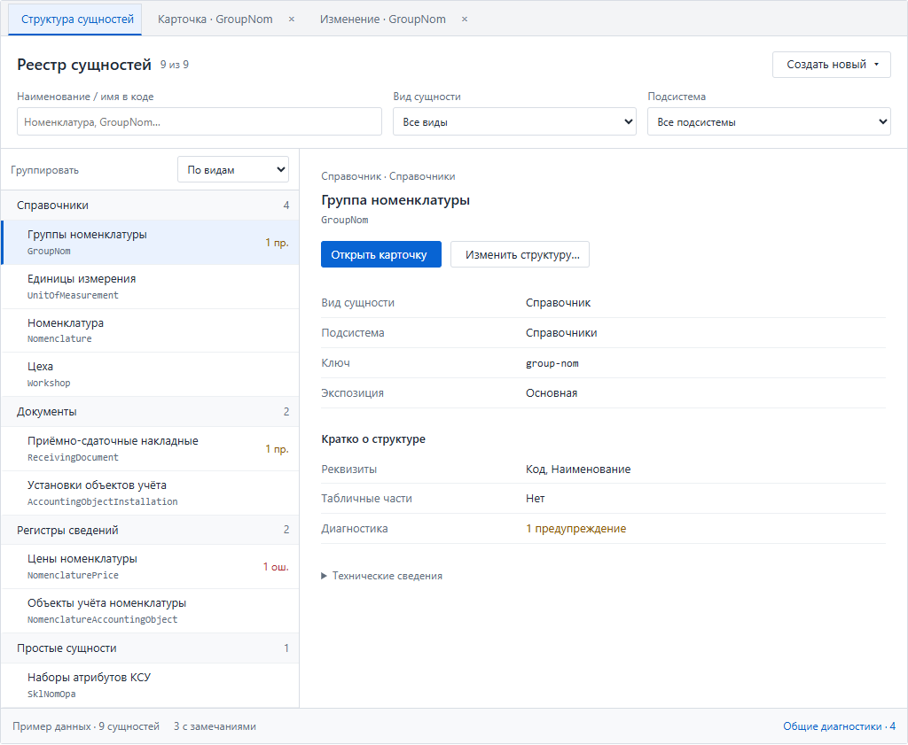

# Реестр сущностей: дерево, обзор и отдельные рабочие вкладки

Дата: 2026-11-10. Редакция 2 — после двух частей замечаний и решения пользователя о границе платформы/приложения.

Статус: план уточнён; реализация Java-приложения не начата. [Первая редакция](entity-registry-ux-plan-rev1.md) сохранена для сопоставления с [разбором замечаний](entity-registry-ux-plan-review.md).

Цель: самостоятельный читаемый реестр «Структура сущностей» с общими платформенными компонентами представления. Приложение подключает навигацию, допуск, генератор и рабочие вкладки.

## 1. Принятые решения и эталон

1. Слева группы и самостоятельные сущности; название и имя класса — двумя строками. Справа краткий обзор и действия **«Открыть карточку»**, **«Изменить структуру…»**.
2. Основные фильтры всегда видны: **«Наименование / имя в коде» → «Вид сущности» → «Подсистема»**. Поиск по подписи и simpleName класса, по подстроке, без учёта регистра; условия пересекаются.
3. Группировка «По видам / По подсистемам» — компактное управление в шапке списка. По умолчанию «По видам».
4. «Создать новый»: справочник, документ, регистр сведений, простая сущность. Последний пункт сохраняется с доступным пояснением до реализации отдельного генераторного среза.
5. Просмотр и изменение структуры открываются разными рабочими вкладками приложения, по одной на тип и режим. Повторная кнопка активирует существующую вкладку. Реестр сохраняет свой выбор и фильтры.
6. Разделы выбираются внутри карточки; отдельного блока «Перейти к разделу» в реестре нет.
7. **Общие компоненты представления находятся в платформе; навигация и рабочие вкладки — в приложении.**

[Интерактивный эталон в проекте](mockups/entity-registry-tree.html), [его исходный фрагмент](mockups/entity-registry-tree.fragment.html), [шесть именованных состояний](mockups/entity-registry-states.md) и [манифест с SHA-256](mockups/entity-registry-states.json) доступны из рабочей копии, независимо от файлов чата. Счётчики и сущности в эскизе демонстрационные.

Набор фиксирует принятую визуальную основу. Конкретизации после ревью, перечисленные ниже, являются явными изменениями к ней: дополнительные административные опции, устранение дублей свойств, более спокойные счётчики, согласованные заголовки вкладок и доступное состояние пункта `PLAIN`. Перед приёмкой R2 они должны быть представлены в актуальных снимках, без неявного выбора между разными картинками.

## 2. Состав реестра и интерфейс

### 2.1. Единица списка

- Единица — самостоятельная root-запись **каталога Explorer**, а не произвольный managed JPA-тип и не отдельный реквизит. Используется действующий `ExplorerSnapshot` и его подтверждённые связи.
- Owned-строки не дублируют самостоятельные сущности в основном списке. Переход к строке разрешается через подтверждённого владельца; неоднозначность показывается по существующему контракту навигации.
- Служебные типы определяются descriptor экспозициями `INTERNAL_STORE`/`UNCLASSIFIED`, а не именем класса. По умолчанию скрыты; при включении одного переключателя `showServiceTypes` проходят ту же группировку по виду/подсистеме. Отдельной третьей иерархии «служебные → вид» нет.
- Пустой descriptor означает неизвестную экспозицию, а не `UNCLASSIFIED`. Ошибка сборки или неизвестный descriptor не делают тип невидимым автоматически.
- `PLAIN` имеет одну подпись «Простая сущность» / «Простые сущности» в общем словаре UI. Неизвестный kind остаётся отдельным состоянием, не попадает в `PLAIN`. `AUTO` не становится допустимым resolved видом.
- Точные количества фиксируются при R0 из актуального снимка с датой, состоянием checkout и командой измерения. Исторические 16/5/16, 21/7/16, числа published-типов и девять примеров макета не подставляются друг вместо друга.

### 2.2. Фильтры и состояние списка

- Основные поля — три согласованных фильтра. В компактных дополнительных настройках сохраняются действующие `onlyErrors`, `showServiceTypes` и технический фильтр экспозиции; у каждого один контрол и одно поле состояния.
- `showServiceTypes` из предыдущего пункта и переключатель в дополнительных настройках — **один и тот же** переключатель «Показать служебные типы», по умолчанию выключенный.
- «Только ошибки» сохраняет действующую семантику ERROR / `BUILD_FAILED`; не заменяется фильтром всех предупреждений. Неизвестные счётчики не трактуются как отсутствие ошибок.
- Фильтры применяются к типам до группировки. Сброс очищает запрос, вид, подсистему и дополнительные условия, возвращая их начальные значения; группировка — самостоятельная настройка.
- «Все виды», «Все подсистемы» снимают ограничения; «Без подсистемы» позволяет найти такие записи явно. Пробелы по краям запроса игнорируются.
- Поиск реестра сопоставляет подпись и имя класса. Совпадение только с реквизитом не показывает тип как совпадение; существующий подробный индекс и адресные переходы к полям/секциям сохраняются у других потребителей.
- Идентичность типа/группы не зависит от подписи и объекта фильтрованной проекции. Раскрытия сохраняются по стабильным ключам.
- Первый вход без выбора — приглашение выбрать сущность. Если фильтр скрывает текущий выбор, выбирается первая доступная запись; при пустом результате обзор очищается, доступны сообщение и сброс.

### 2.3. Обзор, диагностика и доступность

- Вид и подсистема показываются один раз: в строке над названием; повторяющиеся строки свойств под кнопками убираются. Ключ/экспозиция и краткий состав берутся из настоящих фактов.
- Для больших сущностей выводятся первые несколько подписей реквизитов/секций и текстовое «ещё N». Обзор не превращается во вторую полную карточку.
- Классы, адрес и источники находятся в сворачиваемых технических сведениях. UI ничего не резолвит и не читает из БД самостоятельно.
- Без фильтров достаточно «N сущностей», с фильтрами — «Найдено N из M». Число типов в группе и диагностик у типа не смешиваются. Повторяющийся нижний агрегат «N с замечаниями» убирается; общие непривязанные сообщения имеют отдельный настоящий счётчик.
- Диагностика с `countsKnown = false` показывается как недоступная, а не как ноль. ERROR/WARNING различаются текстом/значком. Общие диагностики открываются в одной отдельной служебной вкладке.
- На 736 px длинное имя класса и счётчик не пересекаются; полное имя доступно без обязательного hover. На узкой области список и обзор показываются последовательно с возвратом к списку.
- «Открыть список» — отдельная возможность, не третья обязательная кнопка этого среза. Существующее действие строки обратной ссылки не считается готовым действием для root.

## 3. Граница платформы и приложения

### 3.1. Платформа (`org.ipro`, UI — `platform-vaadin`)

| Компонент / контракт | Ответственность |
|---|---|
| Существующие `EntitySummary`, `ExplorerSnapshot`, сборщики фактов | Готовые immutable факты, их доступность, происхождение и классификация. |
| `EntityExplorerRegistryPanel` | Дерево, фильтры, группировка, обзор, дополнительные опции и события пользовательских действий. |
| `EntityExplorerCardPanel` | Переиспользуемое представление одного типа на основе существующих подробной/компактной панелей. |
| `EntityExplorerDiagnosticsPanel` | Отображение общих диагностик переданного снимка. |
| `EntityExplorerRegistryModel/State`, `EntityExplorerCardState`, модель места и нужные вспомогательные компоненты | Нейтральная проекция и состояние отображения; без привязки к прикладному Workspace и правилам `ADMIN`. |
| Компонентные CSS-ресурсы | Поставка оформления вместе с панелями через принятый в модуле механизм; приложение задаёт свою тему. |

Панели получают снимок, нейтральное состояние, доступность действий и callbacks/порты. В платформенном UI нет импортов `org.ip.*`, конкретных `Nomenclature`/`ReceivingDocument`, `MainLayout`, прикладных feature flags, source-root и сервисов применения файлов. Доступ к исходникам в панели подключается нейтральным необязательным портом; его защищённую реализацию предоставляет приложение. Контракт создания передаёт вид, а не собственную копию списка версий рецептов.

Переносится согласованный набор представления: панели, модель места/состояния, словари и требуемые вспомогательные классы/ресурсы. Перенос одного файла с оставшимися прикладными зависимостями не считается завершённым выделением. Действующая политика выбора подробного/компактного режима сохраняется в приложении; расширение компактного режима на все типы не подразумевается.

### 3.2. Приложение (`org.ip`)

| Компонент | Ответственность |
|---|---|
| `EntityExplorerCatalog` (`@UIScope`) | Проверенный общий снимок текущего контекста, его ревизия и явная инвалидация; использует платформенный сборщик. |
| `EntityExplorerUiSession` (`@UIScope`) | Владелец состояния реестра на время UI и состояний открытых карточек; не Vaadin-компонент. |
| `EntityExplorerRegistryView`, `EntityExplorerCardView`, `EntityExplorerDiagnosticsView` | Тонкие оболочки платформенных панелей; один компонент на рабочую вкладку. |
| `EntityExplorerWorkspace` (`@UIScope`) | Открытие/активация, индекс ссылок на живые карточки, проводка callbacks, адреса и освобождение после закрытия. |
| `MainLayout`, `EntityExplorerNavigation`, доступ, политика пилота | Меню, адресный/программный вход, роли и выбор режима представления. |
| Существующие `EntityModifyWorkspace`, `EntityDraftWorkspace`, `EntityDraftProjectCatalog` | Изменение, создание и адаптация общего снимка для генератора. |
| Общий прикладной helper заголовков | Одинаковая идентификация в просмотре и изменении: русская подпись, префикс режима, код/FQCN в доступной подсказке; различение одинаковых подписей. |

### 3.3. Жизненный цикл и refresh

Состояние реестра хранится в `EntityExplorerUiSession`, а не только в полях его компонента. Закрытие и повторное открытие реестра в том же UI восстанавливает фильтры, группировку, раскрытия и допустимый выбор. Состояние закрытой карточки и ссылка на её компонент удаляются; состояния остальных вкладок сохраняются. Точное имя старого `ExplorerUiState` не является обязательным: нейтральное состояние представления и UI-scoped прикладной владелец разделены.

Смена principal/ролей/локали проверяется на входе и активации, применяет действующие правила очистки и допуска ко всем потребителям; новое UI не наследует чужие факты/ввод.

`EntityDraftProjectCatalog.current()` использует новый общий каталог. Его `refresh()` вызывает единый протокол инвалидации: общий снимок и его ревизия обновляются, кеши представления всех открытых read-only карточек помечаются устаревшими, активная карточка перестраивается или обновляется при следующей активации с сохранением допустимого места. Одного `catalog = null` недостаточно: прежний `invalidateDesignCatalog()` также очищает `panels` и `pilotPanels`.

Инвалидация каталога не уничтожает незаконченные сессии модификации/создания. Проверки актуальности плана исходников остаются у существующих сервисов. Метаданные отражают запущенную сборку: запись Java-файла не означает загрузку новой структуры в работающий JVM; для таких изменений действует пересборка/перезапуск.

## 4. Вкладки, экземпляры и адреса

Нормативная конкретизация: [матрица входов и истории](entity-registry-entry-matrix.md). Она определяет entry id, создание/активацию, адрес, запись истории, состояние и dirty-guard для каждого входа.

### 4.1. Получение существующей карточки

Выбран конкретный механизм без изменения API Workspace: `EntityExplorerWorkspace` хранит `Map<String, EntityExplorerCardView>` по образцу `EntityModifyWorkspace`. Новый компонент создаёт `Workspace.open(Class, …)` через `WorkspaceManager` и его вызов `beanFactory.createBean(...)`; initializer добавляет успешно инициализированную карточку в индекс host'а. Уже открытая карточка берётся из этого индекса; повторный initializer не ожидается. При закрытии/неудачном создании ссылка удаляется.

**Явный адресный запрос применяется к существующей карточке до её активации.** При первом создании место применяется внутри initializer. Адрес конкретного entry регистрируется до активации; повторная кнопка из реестра сохраняет текущее место карточки. Сигнал смены места замыкает entry id данной карточки. Обходного вызова `manager.getOrCreate` ради чтения кеша нет.

Происхождение запроса различается явно: cold URL/история не пишут адрес повторно; программный переход к уже активной карточке обновляет адрес через `tabAddressChanged`, не ожидая события её активации. При программном применении места обратный пользовательский callback подавляется.

Создание новой сущности относится к действию реестра; изменение — к существующему host'у редактора; место/URI — к соответствующей карточке. Сообщение об owned-секции передаётся в запрос целевой карточки. Общие диагностики отображает отдельная платформенная панель в прикладной служебной вкладке, а не `showStructureDetail()`.

### 4.2. Новый реестр всегда безадресен

Выбор типа в новом реестре меняет только обзор; URL остаётся `/`. Адрес `/entity-explorer/{publishedKey}` принадлежит отдельной карточке после открытия. Это одинаково для реестра без выбора и с выбором. Старый совмещённый `EntityExplorerView` по выключенной новой ветке сохраняет прежнее адресное поведение.

Сохраняются грамматика `/entity-explorer/{publishedKey}`, `?view=<tab>[/<section>]`, legacy-ключи, `?continue` и единый отказ. Тип без published-ключа получает безадресную карточку, а не выдуманный URL. Вход из меню ведёт в реестр; холодная ссылка и программная навигация — в карточку разрешённого типа/владельца, не сбрасывая реестр.

Действующая запись истории: безадресная активация — `replace("/")`; смена адресованной вкладки/места — `push` при отличающемся URL; закрытие активной — `replace`; Back/Forward повторно URL не записывает. Общий `addresslessEntryId` требует проверок нескольких безадресных вкладок и их закрытия. Точное восстановление каждого безадресного окна из одного `/` не обещается; изменение browser history state было бы отдельным контрактом.

Дополнение ADR-0010 затрагивает §8, §11 и применение §4 к новым entry id/истории. Исторические измерения прежнего среза остаются историческими; новые результаты записываются отдельно.

## 5. Создание и изменение

- «Изменить структуру…» использует `EntityModifyWorkspace.open(type)` и существующие возможности редактора. Доступность и причина отказа поступают от сервиса; допуск команд и переключатель записи исходников продолжают проверяться сервером.
- Заголовки просмотра и изменения формируются одним прикладным правилом. Полное имя доступно с клавиатуры; одинаковые русские подписи различимы по коду/FQCN.
- «Создать новый» передаёт выбранный вид существующему генератору. Возможности и версии берутся из описателей рецептов. Выбор другого вида не стирает открытый черновик молча: сохраняется текущий контракт `EntityDraftWorkspace` и dirty-guard его замены.
- **Создание `PLAIN` вынесено в [самостоятельный план](plain-entity-creation-plan.md) и не блокирует готовность реестра.** Четвёртый пункт остаётся с доступным без hover пояснением недоступности; команда создания не исполняется до поддерживаемого рецепта. Нативный disabled-пункт с единственным пояснением в hover-tooltip этому требованию не соответствует.
- `EXISTING_ENTITY` не используется как рецепт создания. Профили регистра и остальные генераторные возможности не расширяются появлением пункта меню.

## 6. Последовательность внедрения и откат

| Этап | Работа | Проверяемый результат |
|---|---|---|
| **R0. Зафиксировать контракт** | Матрица, границы модулей/состояния, механизм карты карточек, эталонные состояния, дополнение ADR, актуальное измерение состава. | Указаны реальные артефакты и правила каждого перехода. Нет неназванного владельца карточки/состояния. |
| **R1. Чистый рефакторинг фактов** | Выделить общий каталог и refresh-протокол; подключить навигацию и `EntityDraftProjectCatalog`; сохранить старый UI. | Целевые существующие тесты проходят с прежними ожиданиями поведения; снимок общий, старое представление не изменено. |
| **R2. Платформенные компоненты** | Выделить нейтральные панели/состояние/помощники и ресурсы; собрать проекцию нового реестра, фильтры и обзор. | Компоненты работают на переданном снимке без `org.ip.*`; самостоятельные тесты и снимки целевого широкого/узкого интерфейса. |
| **R3. Прикладные оболочки и вкладки** | Подключить session, host и callbacks, адресные/программные входы и отдельные entry id. Новый экран — за отдельным флагом. | Две карточки и редактор одновременно; повторный явный якорь применён к правильному экземпляру; матрица истории проверена. |
| **R4. Действия и полная проводка** | Меню создания, вход с видом, изменение, общая диагностика, симметричные заголовки и причины недоступности. | Три существующих вида создания работают; `PLAIN` объяснён доступно; черновики и ввод сохраняются по контракту. |
| **R5. Регрессии и живая приёмка** | Проверить платформенную независимость, рабочие вкладки, URI/историю, refresh, фильтры, клавиатуру и размеры. | Evidence с реальными результатами; готовность реестра проверена независимо от нового рецепта `PLAIN`. |
| **R6. Переключение новой ветки** | Включить новый реестр в целевом окружении после проверки. Старую ветку сохранить на период отката. | Переключение конфигурацией на новом UI/запуске; прежняя ветка остаётся проверенным fallback. |
| **R7. Отдельная очистка** | После живой приёмки и завершения периода отката удалить заменённые связи старой оболочки, актуализировать документацию. | Старый путь удалён отдельным изменением, не в момент первого включения нового экрана. |

Флаг новой ветки — `app.entity-explorer.registry.enabled`, начальное значение `false`. `app.entity-explorer.ux-pilot.enabled` сохраняет свою роль выбора компактных карточек и допуска черновиков. Новый флаг не выдаёт прав и не разрешает запись исходников. Режим UI определяется согласованно при входе/создании UI; живое смешение старых и новых entry id не подразумевается.

## 7. Что меняется в коде

| Участок | Изменение |
|---|---|
| `platform-vaadin` | Общие панели, нейтральная модель/состояние представления, словари и вспомогательные UI-компоненты, ресурсы CSS и целевые тесты. Проверка API surface/зависимостей при появлении новых публичных контрактов. |
| `EntityExplorerView`, `ExplorerUiState`, существующие панели приложения | Выделение повторно используемого представления и отделение прикладного жизненного цикла. Старая ветка сохраняется до R7. |
| Новые прикладные `EntityExplorerRegistryView`, `EntityExplorerCardView`, `EntityExplorerWorkspace`, `EntityExplorerUiSession` | Тонкие оболочки, контекст, рабочие вкладки и индекс живых карточек. |
| `MainLayout`, `EntityExplorerNavigation` | Меню и переходы, флаг новой ветки, URI конкретной карточки, доставка сообщения о секции её экземпляру. |
| `EntityDraftProjectCatalog.current()/refresh()` | Получение общего снимка и инвалидация с обновлением read-only панелей, а не зависимость от старого монолитного вида. |
| `EntityDraftWorkspace`, `EntityDraftEditorView`, `EntityModifyWorkspace` | Вход с видом без утраты черновика и единые подписи вкладок; существующие сервисы применения переиспользуются. |
| Тема приложения | Подключение/настройка поставляемых платформой стилей; компонент не требует прикладного CSS-класса для базовой читаемости. |
| Тесты, сценарии измерения, ADR и evidence | Новый контракт владельцев/переходов и проверяемый состав каталога. |

Новый рецепт, Java/DDL генерации `PLAIN`, изменение бизнес-сущностей и прикладной схемы БД относятся к самостоятельной работе, не к выпуску реестра.

## 8. Проверки и готовность

### 8.1. Измерение состава R0

Результат — `docs/architecture/evidence/entity-registry-r0-inventory-YYYYMMDD.json` и сопровождающий протокол: дата/время, HEAD и описание dirty checkout, точная команда, набор managed-типов, entries/roots/owned/service, отказы и область измерения. Указывается реальный production-контекст или явно ограниченная fixture.

На R0 подготовить/зафиксировать воспроизводимую команду `scripts/measure-entity-explorer-catalog.ps1`, использующую действующие ManagedEntityTypes/descriptor-интеграции и общий snapshot. Это **планируемый** скрипт, а не уже выполненное измерение. Существующий `ExplorerSnapshotMeasurement.java` использует standalone-конструктор/сканирование и не должен без проверки области выдаваться за актуальную полную инвентаризацию.

### 8.2. Автоматизированные проверки

- [ ] На R1 старый UI и его целевые тесты сохраняют поведение; refresh учитывает все существующие кеши.
- [ ] Платформенные панели и нейтральные состояния собираются и тестируются без импорта классов приложения; новые публичные поверхности проверены по действующему процессу.
- [ ] Поиск `GroupNom`, `groupnom`, `nomenclature` и русских подписей; пересечение основных и дополнительных условий; единый сброс, пустой результат, «Без подсистемы».
- [ ] Один `showServiceTypes`, правильные значения по умолчанию; unknown descriptor и `BUILD_FAILED` не потеряны; owned-переход разрешается через владельца.
- [ ] Счётчики, общие сообщения и неизвестная диагностика согласованы со снимком.
- [ ] Две карточки разных типов, их разные места и редактор изолированы; повторный `open` не создаёт дубликат. Явный якорь применяется и к существующему экземпляру до активации.
- [ ] Закрытие/повторное открытие реестра в том же UI восстанавливает его состояние; закрытие карточки освобождает индекс, компонент, listeners и её состояние.
- [ ] Все строки матрицы переходов проверены: cold URL, legacy-ключ, `?view`, `?continue`, Back/Forward, закрытие после Back и несколько безадресных вкладок.
- [ ] `EntityDraftProjectCatalog.refresh()` обновляет общий снимок и read-only панели при сохранении ввода редакторов и допустимого места карточек.
- [ ] Заголовки просмотра и изменения используют одну подпись и различимы при совпадениях; полный код доступен без hover.
- [ ] Допуск и смена контекста проверены; новый флаг не меняет права/старый pilot gate. Выключенная запись исходников продолжает запрещать применение.
- [ ] Три существующих вида создания, import/export и переходы из форм/подсистем работают; пункт `PLAIN` доступно объясняет состояние, не открывая неподдерживаемое создание.

Основные существующие проверки: `ExplorerTreeModelTest`, `EntityExplorerViewAddressTest`, `EntityExplorerViewSpringCreationTest`, `EntityExplorerAddressWiringTest`, `EntityExplorerRouteGateTest`, `EntityStructureNavigationTest`, `SubsystemStructureNavigationTest`, тесты Workspace/dirty-guard и `EntityModificationTest`. На R1 прежние ожидания не переписываются под новый UI; новые ожидания новой ветки вводятся на последующих этапах. Штатные скрипты, включая `scripts/test-entity-explorer-structure.ps1`, адаптируются к выделенным классам. Тесты каждой CSS-декларации не нужны.

### 8.3. Живая приёмка

- [ ] Реальные `GroupNom`, `Nomenclature`, `ReceivingDocument`, оба регистра, `SklNomOpa`, служебный тип, тип без подсистемы и отказ сборки метаданных.
- [ ] Ширина 1024/736 px: нет пересечения бейджа с длинным именем класса и общей горизонтальной прокрутки; полное имя доступно с клавиатуры.
- [ ] Узкий список и обзор, возврат, видимые действия и фокус. Меню создания и пояснение `PLAIN` доступны без hover.
- [ ] Фильтрация не теряет фокус ввода; не создаёт повторные сборки метаданных. Плотность соответствует компактным формам приложения.
- [ ] Отдельные вкладки сохраняют места/ввод; реестр с выбором остаётся `/`, URI принадлежит открытой карточке.
- [ ] Проверены включение нового флага и откат к старой ветке на новом UI/запуске.

Результаты реализации фиксируются отдельным evidence. Эта редакция подтверждает план, матрицу и доступность эталонных состояний, а не выполнение будущих Java/интеграционных проверок.
